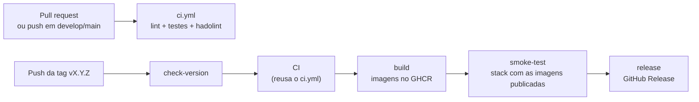

# CI/CD

O projeto tem dois workflows do GitHub Actions, em `.github/workflows/`:

| Workflow | Arquivo | Quando roda | O que faz |
| --- | --- | --- | --- |
| CI | `ci.yml` | Pull requests e pushes para `develop` e `main` | Lint, testes e lint dos Dockerfiles |
| Release | `release.yml` | Push de uma tag `v*` | Publica as imagens, testa a stack e cria a GitHub Release |



## CI (`ci.yml`)

O CI roda em todo pull request para `develop` ou `main` e em todo push nessas
branches, ou seja, também depois de cada merge. Um push em uma branch de
feature sozinho não dispara nada: o CI começa quando o pull request é aberto.

| Job | O que faz |
| --- | --- |
| Lint and tests | Instala o Poetry 2.5.1 e o Python 3.14, roda `poetry run task test` (Ruff, pytest e cobertura) e guarda o `htmlcov/` como artefato `coverage-html` por 1 dia |
| hadolint (Dockerfile) | Lint do `Dockerfile` |
| hadolint (Dockerfile.mkdocs) | Lint do `Dockerfile.mkdocs` |

Os três jobs rodam em paralelo, cada um em uma máquina `ubuntu-26.04` nova, a
mesma versão do Ubuntu usada no desenvolvimento. O job de testes usa o cache
do `setup-python`, indexado pelo hash do `poetry.lock`, para não baixar as
dependências a cada execução.

Na página do pull request aparecem os três checks. O merge só deve ser feito
com todos verdes.

### Variáveis de ambiente no CI

A aplicação lê as configurações ao ser importada, e o `.env` não existe no
runner, porque não é versionado. O job define as quatro variáveis direto no
workflow:

| Variável | Valor no CI | Por que funciona |
| --- | --- | --- |
| `DATABASE_URL` | URL de um PostgreSQL local | Os testes trocam a sessão pela do SQLite em memória; a URL nunca é usada para conectar |
| `JWT_SECRET_KEY` | Texto fixo de 41 caracteres | Os testes criam e validam tokens com a mesma chave. O PyJWT avisa quando a chave HS256 tem menos de 32 bytes |
| `JWT_ALGORITHM` | `HS256` | Mesmo valor do `.env.example` |
| `JWT_EXPIRATION_MINUTES` | `30` | Mesmo valor do `.env.example` |

Nenhum desses valores é segredo. Uma credencial real iria em
**Settings → Secrets and variables → Actions** e seria lida com
`${{ secrets.NOME }}`.

### Relatório de cobertura

O relatório fica na página da execução, em **Actions → (execução) →
Artifacts → coverage-html**. Baixe o zip e abra o `index.html`. Se os testes
falharem, o relatório não é gerado, porque o `post_test` não roda.

## Release (`release.yml`)

O workflow roda quando uma tag que começa com `v` é enviada ao GitHub. Os jobs
formam uma corrente: cada um só começa se o anterior passou.

| Job | O que faz |
| --- | --- |
| `check-version` | Compara a tag (sem o `v`) com a `version` do `pyproject.toml` e para tudo se forem diferentes |
| `CI` | Reaproveita o `ci.yml` inteiro por `workflow_call` |
| `build` | Constrói as duas imagens em paralelo e envia para o GHCR com a tag do Git |
| `smoke-test` | Sobe `db`, `migrations`, `app` e `mkdocs` com as imagens publicadas e chama `/health_check` e a documentação |
| `release` | Cria a GitHub Release com notas geradas a partir dos pull requests |

O `check-version` existe porque uma tag já foi criada em um commit com outra
versão. Com ele, uma tag que não bate com o `pyproject.toml` não publica nada.

### Permissões

O token automático de cada execução (`GITHUB_TOKEN`) começa só com leitura.
Cada job pede apenas o que precisa:

| Job | Permissões |
| --- | --- |
| `check-version`, `CI` | `contents: read` |
| `build` | `contents: read`, `packages: write` |
| `smoke-test` | `contents: read`, `packages: read` |
| `release` | `contents: write` |

O token é criado no início de cada job e expira no fim. O valor nunca aparece
no código nem nos logs.

### Smoke test

Os testes da suíte usam SQLite. O smoke test confere o que eles não alcançam:
a imagem publicada sobe, conecta no PostgreSQL, aplica as migrações e
responde.

O job copia o `.env.example` para `.env` e usa dois arquivos do Compose,
definidos na variável `COMPOSE_FILE`:

- `docker-compose.yml`, com serviços, portas, variáveis e healthcheck;
- `docker-compose.release.yml`, que só troca as imagens dos serviços pelas
  publicadas no GHCR.

Os containers sobem com `--no-build`, para usar as imagens publicadas e não
reconstruir a partir do código. As chamadas com `curl` repetem por até 30
segundos, enquanto a API termina de subir. No fim, os logs são exibidos e a
stack é removida, mesmo se algo falhar.

## Imagens publicadas

| Imagem | Origem |
| --- | --- |
| `ghcr.io/leonardoalmeidagit/car-api:vX.Y.Z` | `Dockerfile` (usada por `app` e `migrations`) |
| `ghcr.io/leonardoalmeidagit/car-api-mkdocs:vX.Y.Z` | `Dockerfile.mkdocs` |

A tag da imagem é a mesma tag do Git e da GitHub Release. As imagens ficam na
aba **Packages** do repositório e do perfil.

Toda imagem nasce privada no GHCR, mesmo com o repositório público. Para
permitir `docker pull` sem login, mude a visibilidade em
**Package settings → Change visibility**. Uma imagem pública não pode voltar a
ser privada.

## Publicando uma versão

O processo completo está em [Contribuição](contributing.md#versionamento). Em
resumo:

1. Atualize a versão (`pyproject.toml`, documentação e Release Notes) em uma
   branch a partir de `develop` e faça o merge.
2. Abra o pull request de `develop` para `main` e faça o merge.
3. Crie a tag a partir da `main` atualizada e envie:

    ```bash
    git switch main
    git pull
    git show HEAD:pyproject.toml | grep '^version'
    git tag -a vX.Y.Z -m "Release vX.Y.Z: resumo"
    git push origin vX.Y.Z
    ```

4. Acompanhe a execução:

    ```bash
    gh run watch
    ```

Não crie a GitHub Release manualmente. O último job do workflow cria a
release, e falha se ela já existir.

## Rodando uma versão publicada

O `docker-compose.release.yml` também serve para rodar uma versão publicada
sem construir as imagens. A variável `IMAGE_TAG` é obrigatória:

```bash
export COMPOSE_FILE=docker-compose.yml:docker-compose.release.yml
IMAGE_TAG=vX.Y.Z docker compose pull app migrations mkdocs
IMAGE_TAG=vX.Y.Z docker compose up -d --no-build
```

Para voltar a uma versão anterior, troque o número e repita os comandos. Se a
versão nova tiver mudado o esquema do banco, siga antes o procedimento de
[Deploy](deployment.md#atualizando-uma-versao).

Enquanto as imagens forem privadas, faça login antes do `pull`, com um token
que tenha a permissão `read:packages`:

```bash
docker login ghcr.io -u <usuario>
```

## Se a release falhar

| Onde falhou | Imagens publicadas? | O que fazer |
| --- | --- | --- |
| `check-version` | Não | Apague a tag, corrija a versão e crie a tag de novo |
| `CI` | Não | Corrija em um pull request, apague a tag e crie de novo no commit novo |
| `build` | Talvez uma das duas | Se foi falha passageira, rode de novo os jobs que falharam. Se exige mudança no código, publique a correção como a próxima versão de patch |
| `smoke-test` | Sim | Mesmo caso do `build` |
| `release` | Sim | Rode de novo o job. Se a release foi criada à mão antes, apague-a |

Para apagar uma tag, local e no GitHub:

```bash
git tag -d vX.Y.Z
git push origin :refs/tags/vX.Y.Z
```

Para rodar de novo só os jobs que falharam:

```bash
gh run rerun <id-da-execucao> --failed
```

Depois que as imagens de uma versão foram publicadas, prefira não reaproveitar
o mesmo número. Uma versão nova evita que duas imagens diferentes tenham
existido com a mesma tag.

## Validando antes do push

Os workflows podem ser conferidos localmente. O actionlint valida a sintaxe,
as expressões e os scripts de shell (com o ShellCheck):

```bash
docker run --rm -v "$PWD":/repo -w /repo rhysd/actionlint:1.7.12 -color
```

O `.github/actionlint.yaml` declara o runner `ubuntu-26.04`, que é mais novo
que a versão 1.7.12 do actionlint. O GitHub ignora esse arquivo.

Os mesmos comandos do CI:

```bash
poetry run task test
hadolint Dockerfile Dockerfile.mkdocs
```

E o Compose de release, sem exibir os valores do `.env`:

```bash
IMAGE_TAG=teste docker compose -f docker-compose.yml \
    -f docker-compose.release.yml config --quiet
```
