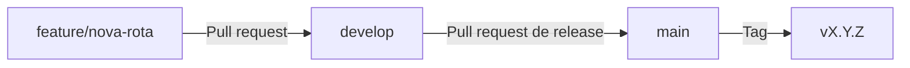

# Contribuição

## Fluxo de branches

| Branch | Uso |
| --- | --- |
| `main` | Código publicado; recebe merges de `develop` nas releases |
| `develop` | Integração das alterações em andamento |
| `feature/<descrição>` | Nova funcionalidade |
| `fix/<descrição>` | Correção de erro |
| `chore/<descrição>` | Manutenção, ferramentas e versão |
| `test/<descrição>` | Testes automatizados |
| `docs/<descrição>` | Documentação |



## Passo a passo

1. Atualize a `develop` e crie sua branch:

    ```bash
    git switch develop
    git pull
    git switch -c feature/minha-alteracao
    ```

2. Faça a alteração, seguindo as [guidelines](guidelines.md). Se mudar um modelo,
   inclua a migração.
3. Escreva ou atualize os testes, como descrito em [Testes](testing.md).
4. Valide:

    ```bash
    poetry run task format
    poetry run task test
    ```

    O `task test` executa o lint antes dos testes e para no primeiro erro.

5. Atualize a documentação em `docs/`, se necessário.
6. Faça o commit, envie a branch e abra um pull request para `develop`.

## Mensagens de commit

O projeto segue o padrão
[Conventional Commits](https://www.conventionalcommits.org/pt-br/), com mensagens
em inglês:

```text
<tipo>: <descrição no imperativo>
```

| Tipo | Uso | Exemplo do histórico |
| --- | --- | --- |
| `feat` | Nova funcionalidade | `feat: add JWT authentication` |
| `fix` | Correção de erro | `fix: correct user update endpoint` |
| `chore` | Manutenção, ferramentas e versão | `chore: bump version to 0.3.0` |
| `docs` | Documentação | `docs: add mkdocs configuration` |
| `test` | Testes automatizados | `test: add unit tests with pytest` |
| `style` | Formatação, sem mudança de comportamento | `style: apply ruff format and lint fixes` |
| `build` | Sistema de build, dependências e Docker | `build: add Docker and PostgreSQL setup` |

## Pull requests

Antes de pedir revisão, confira:

- O título segue o padrão de commits.
- `task test` passa sem erros, incluindo o lint.
- O comportamento novo ou alterado tem testes, e a cobertura continua acima
  de 80%.
- Mudanças em modelos incluem migração, aplicada no PostgreSQL local, e os
  limites correspondentes nos schemas.
- Mudanças em dependências, Dockerfiles ou `docker-compose.yml` foram
  conferidas com `docker compose up -d --build`.
- Nenhum segredo ou banco de dados foi incluído no commit.
- A documentação foi atualizada.
- O README foi atualizado, se a mudança altera a instalação, os comandos ou as
  tecnologias.

## Versionamento

O projeto segue o [Versionamento Semântico](https://semver.org/lang/pt-BR/). Ainda
na série `0.x`, novas funcionalidades incrementam o número do meio.

Para publicar uma versão:

1. Em uma branch a partir de `develop`, atualize `version` no `pyproject.toml`,
   com o commit `chore: bump version to X.Y.Z`.
2. Atualize as [Release Notes](release-notes.md).
3. Faça o merge em `develop` e, depois, abra o pull request de `develop` para
   `main`.
4. **Depois do merge em `main`**, atualize a branch local e crie a tag anotada:

    ```bash
    git switch main
    git pull
    git tag -a vX.Y.Z -m "Release vX.Y.Z: resumo"
    git push origin vX.Y.Z
    ```

Antes de enviar a tag, confira se ela contém a versão correta:

```bash
git show vX.Y.Z:pyproject.toml | grep '^version'
```
