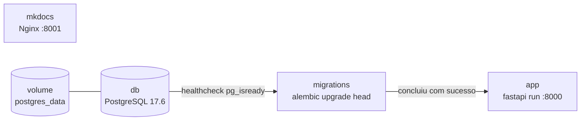

# Docker

O projeto tem um ambiente completo em Docker Compose: a API, o PostgreSQL, um
serviço que aplica as migrações e um servidor com esta documentação.

## Serviços

| Serviço | Imagem | Porta no host | Função |
| --- | --- | --- | --- |
| `db` | `postgres:17.6-bookworm` | `127.0.0.1:5432` | Banco PostgreSQL, com dados no volume `postgres_data` |
| `migrations` | `car_api:latest` | Nenhuma | Roda `alembic upgrade head` e encerra |
| `app` | `car_api:latest` | `8000` | API em `fastapi run` |
| `mkdocs` | `car-api-mkdocs:latest` | `8001` | Documentação estática servida pelo Nginx |

Os serviços sobem nesta ordem:



1. O `db` sobe e o *healthcheck* executa `pg_isready` a cada 5 segundos, com
   até 10 tentativas.
2. Quando o banco fica saudável, o `migrations` aplica as migrações pendentes.
3. Só se as migrações terminarem com sucesso (código de saída 0) o `app` sobe.

O `mkdocs` não depende dos outros serviços.

## Primeira execução

Crie o `.env` a partir do modelo e troque `JWT_SECRET_KEY` e `DB_PASSWORD`:

```bash
cp .env.example .env
python3 -c "import secrets; print(secrets.token_urlsafe(64))"
```

Construa as imagens e suba tudo em segundo plano:

```bash
docker compose up -d --build
```

Confira o estado dos serviços:

```bash
docker compose ps -a
```

O `db` deve aparecer como `healthy`, o `migrations` como `Exited (0)` e o `app`
como `Up`. Depois, teste a API:

```bash
curl http://127.0.0.1:8000/health_check
```

| Recurso | URL |
| --- | --- |
| API | <http://127.0.0.1:8000/api/v1> |
| Swagger UI | <http://127.0.0.1:8000/docs> |
| Documentação do projeto | <http://127.0.0.1:8001> |

## Variáveis de ambiente no Compose

O `docker-compose.yml` usa o `.env` de duas formas:

- **Interpolação**: o Compose substitui `${DB_NAME}`, `${DB_USER}` e
  `${DB_PASSWORD}` no próprio arquivo, lendo o `.env` da raiz do projeto.
- **`env_file`**: o `app` e o `migrations` recebem todas as variáveis do `.env`,
  incluindo as do JWT.

Nos serviços `app` e `migrations`, a chave `environment` redefine
`DATABASE_URL` para usar o host `db`, que é o nome do serviço na rede do Compose:

```yaml
DATABASE_URL: postgresql+psycopg://${DB_USER}:${DB_PASSWORD}@db:5432/${DB_NAME}
```

Como `environment` tem prioridade sobre `env_file`, o `DATABASE_URL` do `.env`,
que aponta para `localhost`, só vale quando a API roda fora do Docker.

> **Atenção:** O Postgres só usa `DB_USER` e `DB_PASSWORD` ao criar o volume
> pela primeira vez. Alterar esses valores depois não muda o usuário existente:
> a API passa a falhar na autenticação com o banco. Veja
> [Problemas comuns](#problemas-comuns).

## A imagem da API (`Dockerfile`)

| Etapa | O que faz |
| --- | --- |
| `FROM python:3.14-alpine3.24` | Base Alpine com Python 3.14 |
| `adduser ... car_api` e `USER car_api` | A aplicação roda como usuário sem privilégios, em `/home/car_api` |
| Instalação do Poetry | Poetry 2.5.1, pelo instalador oficial |
| `COPY pyproject.toml poetry.lock` e `poetry install --no-root --without dev` | Instala só as dependências da aplicação, num `.venv` dentro do projeto |
| `COPY . .` | Copia o código, respeitando o `.dockerignore` |
| `CMD` | `poetry run fastapi run car_api/app.py`, que escuta em `0.0.0.0:8000` |

As dependências são copiadas e instaladas antes do código. Assim, alterar um
arquivo `.py` não reinstala as dependências no próximo build: o Docker reutiliza
essa camada enquanto `pyproject.toml` e `poetry.lock` não mudarem.

O `migrations` usa a mesma imagem, apenas trocando o comando para
`poetry run alembic upgrade head`.

### O que fica fora da imagem

O `.dockerignore` exclui, entre outros, `.env`, `.git/`, `.venv`, caches,
`htmlcov/`, `tests/` e `car.db`. Consequências:

- **Os segredos não entram na imagem**: o `.env` é lido pelo Compose em tempo de
  execução.
- **Os testes não rodam no contêiner**: a imagem não tem `tests/` nem as
  dependências de desenvolvimento. Rode-os localmente, como descrito em
  [Testes](testing.md).

## A imagem da documentação (`Dockerfile.mkdocs`)

O build tem dois estágios:

1. **`builder`**: instala as versões de `requirements_docs.txt` e roda
   `mkdocs build --strict`. Um link quebrado ou uma página fora do `nav` faz o
   build falhar.
2. **`production`**: copia o site gerado para uma imagem `nginx:alpine`, que o
   serve na porta 80 do contêiner (8001 no host).

A imagem final não tem Python nem MkDocs, só os arquivos estáticos.

## Comandos do dia a dia

| Comando | O que faz |
| --- | --- |
| `docker compose up -d --build` | Constrói as imagens e sobe todos os serviços |
| `docker compose up -d db` | Sobe só o banco, para rodar a API fora do Docker |
| `docker compose ps -a` | Mostra o estado de todos os serviços, inclusive os encerrados |
| `docker compose logs -f app` | Acompanha os logs da API |
| `docker compose logs migrations` | Mostra a saída da última execução das migrações |
| `docker compose restart app` | Reinicia a API |
| `docker compose stop` | Para os serviços, mantendo contêineres e dados |
| `docker compose down` | Remove os contêineres, mantendo o volume do banco |
| `docker compose down -v` | Remove os contêineres **e os dados** do banco |

### Aplicar uma migração nova

Depois de criar a migração, reconstrua a imagem e rode o serviço de migrações:

```bash
docker compose build migrations
docker compose run --rm migrations
```

Para consultar a revisão atual ou o histórico, troque o comando:

```bash
docker compose run --rm migrations poetry run alembic current
docker compose run --rm migrations poetry run alembic history
```

### Acessar o banco

O `psql` do contêiner usa as variáveis do próprio contêiner, então o comando
funciona com qualquer usuário definido no `.env`:

```bash
docker compose exec db sh -c 'psql -U "$POSTGRES_USER" -d "$POSTGRES_DB"'
```

A porta 5432 também fica disponível em `127.0.0.1`, para clientes gráficos como
DBeaver ou pgAdmin.

### Atualizar o código em execução

O código é copiado para a imagem no build, não montado como volume. Depois de
alterar o código, reconstrua:

```bash
docker compose up -d --build app
```

Para desenvolver com recarregamento automático, rode a API fora do Docker com o
banco no contêiner, como descrito em [Instalação](installation.md#opcao-2-poetry-com-o-banco-no-docker).

### Recriar o banco do zero

> **Perigo:** Este procedimento apaga todos os dados do PostgreSQL.

```bash
docker compose down -v
docker compose up -d --build
```

## Problemas comuns

| Sintoma | Causa provável | Solução |
| --- | --- | --- |
| `app` não sobe e `migrations` aparece como `Exited (1)` | Falha nas migrações | Veja o erro com `docker compose logs migrations` |
| `password authentication failed for user` | `DB_USER` ou `DB_PASSWORD` mudou depois de o volume ser criado | Volte aos valores originais ou recrie o banco com `docker compose down -v` |
| `role "..." does not exist` ao usar `psql` | Usuário diferente do definido em `DB_USER` | Use o comando com `$POSTGRES_USER` mostrado acima |
| `Bind for 0.0.0.0:8000 failed: port is already allocated` | `task run` ou outro processo já usa a porta | Pare o outro processo ou o serviço `app` |
| `Bind for 127.0.0.1:5432 failed` | Um PostgreSQL local já usa a porta | Pare o serviço local ou altere a porta publicada |
| A API não reflete uma alteração no código | A imagem não foi reconstruída | `docker compose up -d --build app` |
| Build do `mkdocs` falha com `Aborted with ... warnings in strict mode` | Link quebrado ou página fora do `nav` | Rode `poetry run mkdocs build --strict` e corrija o aviso |
