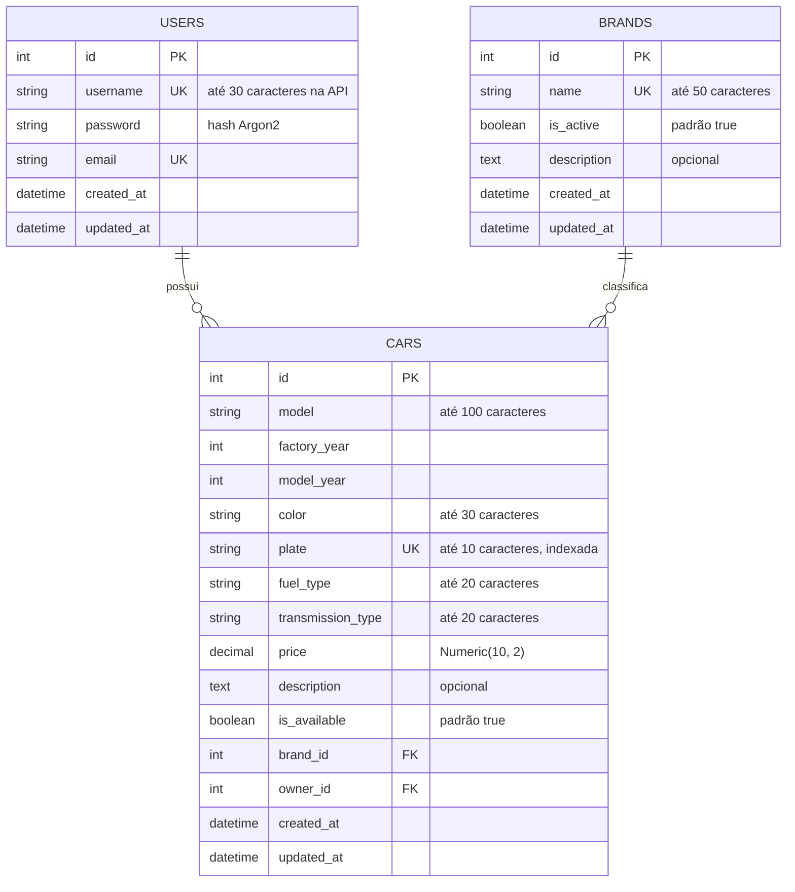
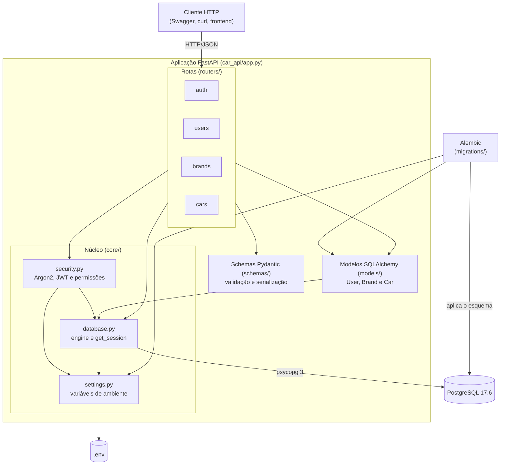
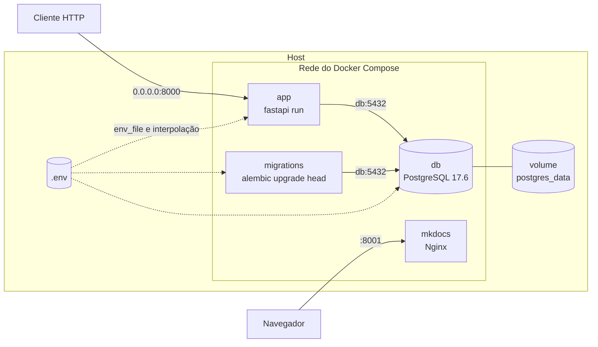
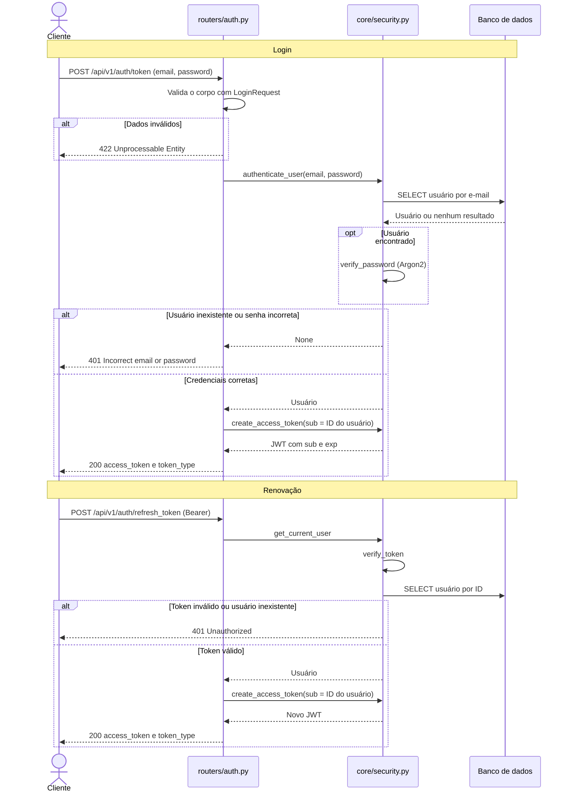
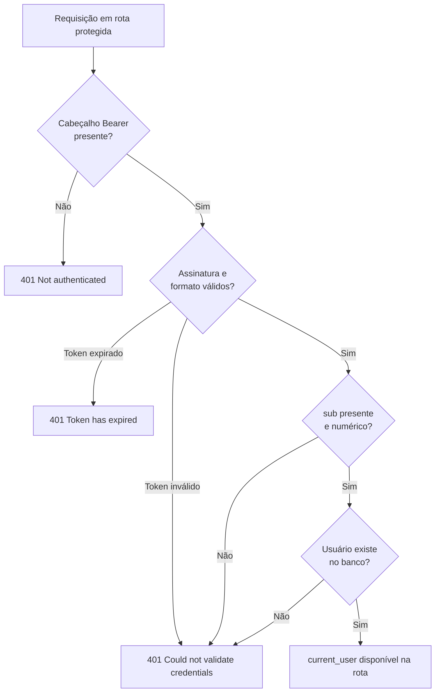
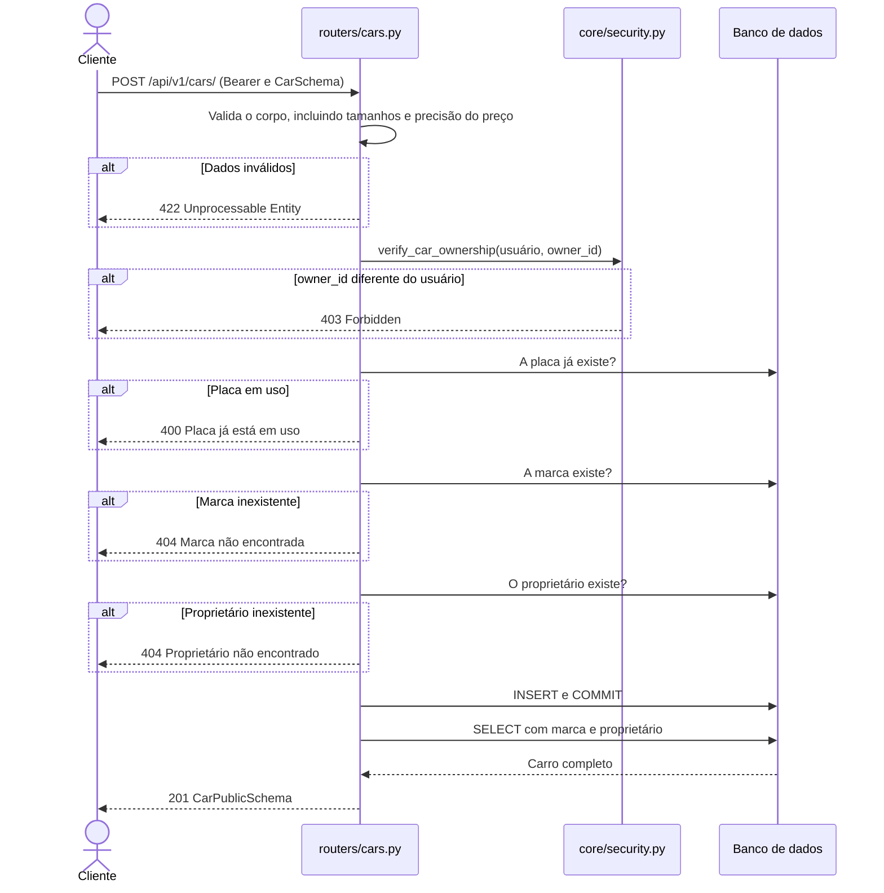
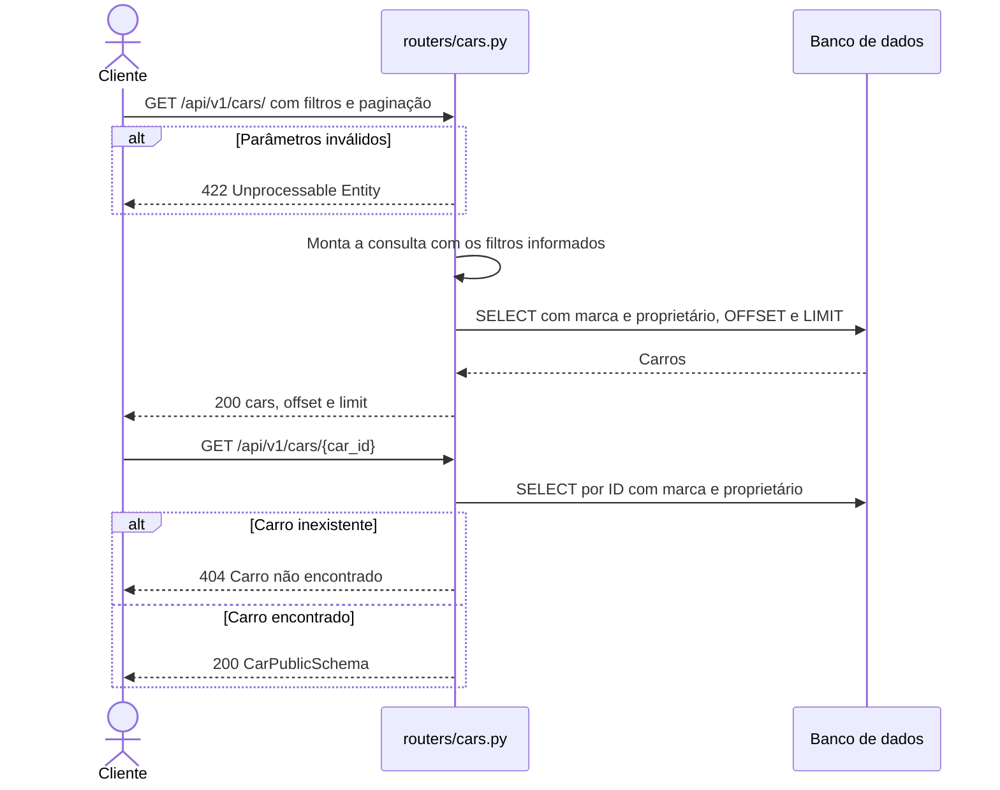
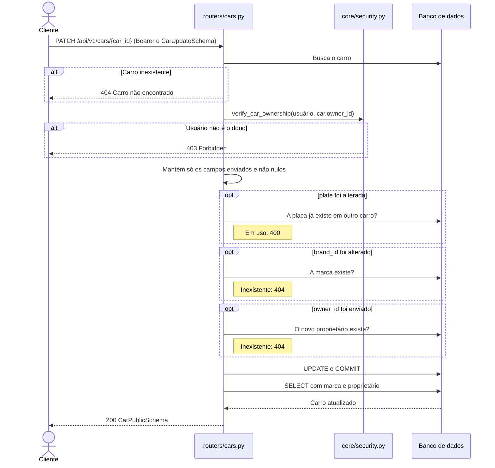
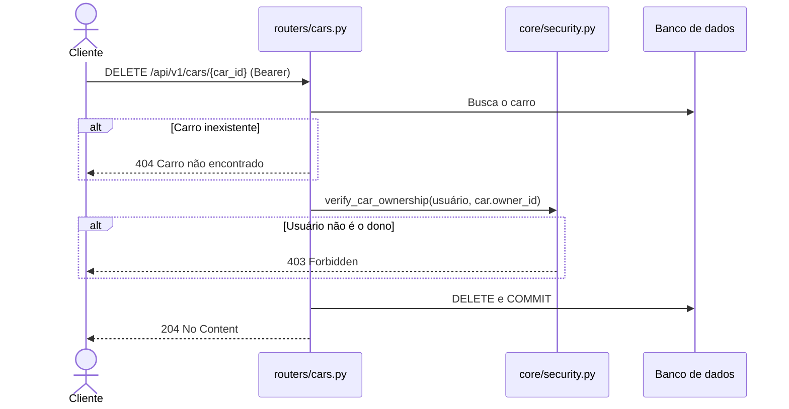
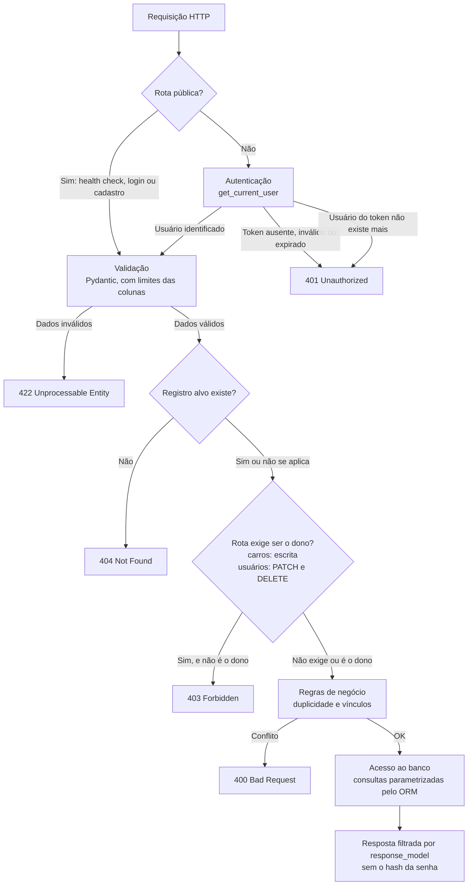

# Modelagem do Sistema

## Modelos de Dados

### Tamanho das colunas

No PostgreSQL, `String(n)` vira `VARCHAR(n)`, e o banco recusa valores maiores.
Os schemas repetem esses limites com `max_length` e `max_digits`, para que a API
responda `422` em vez de deixar o erro chegar ao banco como `500`:

| Coluna | Banco | Schema |
| --- | --- | --- |
| `users.username` | `VARCHAR`, sem limite | `max_length=30` |
| `brands.name` | `VARCHAR(50)` | `max_length=50` |
| `cars.model` | `VARCHAR(100)` | `max_length=100` |
| `cars.color` | `VARCHAR(30)` | `max_length=30` |
| `cars.plate` | `VARCHAR(10)` | Validador de 7 a 10 caracteres |
| `cars.price` | `NUMERIC(10, 2)` | `max_digits=10`, `decimal_places=2` |

`users.email` e `users.password` não têm limite no banco nem no schema. O
`username` tem limite apenas na API.

### Relacionamentos

| Relação | Cardinalidade | Regra |
| --- | --- | --- |
| Usuário e carros | Um usuário tem zero ou mais carros; todo carro tem um dono | A API bloqueia a exclusão de usuário com carros |
| Marca e carros | Uma marca tem zero ou mais carros; todo carro tem uma marca | A API bloqueia a exclusão de marca com carros |

### Enumerações

`fuel_type` e `transmission_type` são armazenados como texto. Os valores
permitidos são validados pelo Pydantic na API, não por uma restrição no banco.

| Enum | Valores |
| --- | --- |
| `FuelType` | `gasoline`, `ethanol`, `flex`, `diesel`, `electric`, `hybrid` |
| `TransmissionType` | `manual`, `automatic`, `semi_automatic`, `cvt` |

## Arquitetura do Sistema

A aplicação é um monólito em camadas. Cada requisição passa pelas rotas, que
usam os schemas para validar os dados, as dependências de segurança para
identificar o usuário e os modelos para acessar o banco.

## Implantação em contêineres

No Docker Compose, a aplicação e as migrações usam a mesma imagem e falam com o
banco pela rede interna do Compose, pelo host `db`.

A porta 5432 também é publicada, mas só em `127.0.0.1`, para a API rodando
fora do Docker e para clientes de banco locais. Os detalhes estão em
[Docker](docker.md).

## Fluxo de Autenticação

### Login e renovação do token

### Validação do token em rotas protegidas

## Fluxo CRUD de Carros

Todas as operações passam antes pela
[validação do token](#validacao-do-token-em-rotas-protegidas).

### Criar

> **Nota:** A checagem de proprietário existe no código, mas nunca devolve
> `404`: como `verify_car_ownership` já exige que `owner_id` seja o usuário
> autenticado, o proprietário sempre existe. Por isso essa é a única linha das
> rotas sem cobertura de testes.

### Listar e buscar

### Atualizar

### Excluir

## Fluxo de Segurança

O diagrama mostra as camadas de proteção de uma requisição até a resposta.

> **Ordem real das etapas**
>
> O diagrama simplifica a ordem. O FastAPI resolve as dependências e valida o
> corpo antes de executar a função da rota, por isso `401` e `422` ocorrem
> antes das demais verificações. Na criação de carro, a verificação de
> proprietário (`403`) vem antes das checagens de placa e marca.

Os detalhes de cada mecanismo estão em
[Autenticação e Segurança](authentication.md).
