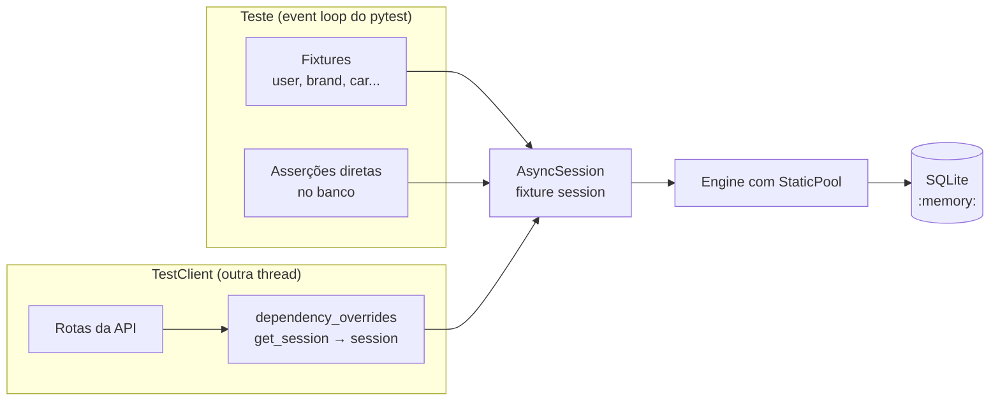

# Testes

O projeto tem uma suíte de testes automatizados com **pytest**, executada contra
um banco SQLite em memória, separado do `car.db` da aplicação.

| Item | Valor |
| --- | --- |
| Framework | pytest, com pytest-asyncio e pytest-cov |
| Banco dos testes | `sqlite+aiosqlite:///:memory:`, recriado a cada teste |
| Testes | 163 casos em 5 arquivos |
| Cobertura | 99% das linhas de `car_api/` |
| Meta de cobertura | Acima de 80% |

> **Nota:** Os números acima foram medidos na revisão da documentação, com a
> suíte atual. Eles mudam conforme testes são adicionados; o valor atualizado
> aparece sempre no final de `task test`.

## Executando os testes

```bash
poetry run task test
```

A tarefa executa três etapas em sequência:

| Etapa | Comando | O que faz |
| --- | --- | --- |
| `pre_test` | `task lint` | Roda o Ruff. Se houver erro de lint, os testes não rodam |
| `test` | `pytest -s -x --cov=car_api -vv` | Roda os testes e mede a cobertura |
| `post_test` | `coverage html` | Gera o relatório HTML em `htmlcov/` |

Opções usadas em `task test`:

| Opção | Efeito |
| --- | --- |
| `-s` | Mostra o `print` dos testes, sem capturar a saída |
| `-x` | Para no primeiro teste que falhar |
| `--cov=car_api` | Mede a cobertura apenas do código da aplicação |
| `-vv` | Lista cada teste com o resultado |

### Execuções parciais

Para rodar só uma parte da suíte, chame o pytest diretamente. Nesse caso, o lint
e o relatório HTML não são executados.

```bash
poetry run pytest tests/test_cars.py              # um arquivo
poetry run pytest tests/test_auth.py::test_refresh_token  # um teste
poetry run pytest -k "delete and not forbidden"   # por nome
poetry run pytest --lf                            # só os que falharam por último
```

### Relatório de cobertura

O resumo aparece no terminal ao final de `task test`. Para ver linha a linha o
que não foi coberto:

```bash
poetry run coverage report -m          # no terminal
xdg-open htmlcov/index.html            # no navegador (no WSL, use explorer.exe)
```

`.coverage` e `htmlcov/` estão no `.gitignore` e não são versionados.

## Configuração

Toda a configuração fica no `pyproject.toml`.

### pytest

```toml
[tool.pytest.ini_options]
pythonpath = "."
filterwarnings = [
    'ignore::starlette.exceptions.StarletteDeprecationWarning',
]
asyncio_default_fixture_loop_scope = 'function'
```

| Opção | Motivo |
| --- | --- |
| `pythonpath = "."` | Permite `import car_api` nos testes sem instalar o pacote |
| `filterwarnings` | Oculta o aviso do Starlette sobre o uso de `httpx` no `TestClient`, que não afeta os testes |
| `asyncio_default_fixture_loop_scope` | Cada teste tem o próprio *event loop*, o que isola os bancos em memória |

O pytest-asyncio roda no modo `strict`, o padrão: testes assíncronos precisam
de `@pytest.mark.asyncio` e fixtures assíncronas, de `@pytest_asyncio.fixture`.

### Coverage

```toml
[tool.coverage.run]
concurrency = ["thread", "greenlet"]
```

O SQLAlchemy assíncrono executa as consultas dentro de *greenlets*, e o
`TestClient` roda a aplicação em outra *thread*. Sem essa opção, o coverage não
registra as linhas executadas nesses contextos e a cobertura das rotas aparece
bem abaixo da real.

### Variáveis de ambiente

Importar `car_api.app` instancia `Settings()`, então o `.env` (ou as variáveis
de ambiente) precisa existir ao rodar os testes. Os valores de `DATABASE_URL`
não são usados pelos testes, já que a sessão é substituída pela do banco em
memória, mas as quatro variáveis continuam obrigatórias. Os tokens dos testes
são assinados com o `JWT_SECRET_KEY` configurado.

## Como o banco de testes funciona



1. A fixture `engine` cria uma engine para `sqlite+aiosqlite:///:memory:` e
   executa `Base.metadata.create_all`.
2. A fixture `session` abre uma `AsyncSession` sobre essa engine.
3. A fixture `client` substitui a dependência `get_session` pela mesma sessão,
   com `app.dependency_overrides`.
4. Ao final do teste, as tabelas são removidas, a engine é descartada e o
   override é limpo.

Como fixtures, rotas e asserções compartilham a mesma sessão, um registro criado
por uma fixture é visto pela API, e o que a API grava pode ser consultado no
teste.

> **Por que `StaticPool`?**
>
> No SQLite, cada nova conexão a `:memory:` abre um banco **vazio**. O
> `StaticPool` faz a engine reutilizar uma única conexão, garantindo que todas as
> operações do teste enxerguem as mesmas tabelas e os mesmos dados.

## Fixtures disponíveis

Definidas em `tests/conftest.py`. Use-as como parâmetros da função de teste.

### Infraestrutura

| Fixture | Tipo | Fornece |
| --- | --- | --- |
| `engine` | assíncrona | Engine do banco em memória, com as tabelas criadas |
| `session` | assíncrona | `AsyncSession` usada por testes, fixtures e API |
| `client` | síncrona | `TestClient` com `get_session` substituído |

### Dados

| Fixture | Conteúdo |
| --- | --- |
| `user` | Usuário `usuario_teste` (`usuario@teste.com`) |
| `other_user` | Usuário `outro_usuario` (`outro@teste.com`) |
| `brand` | Marca `Toyota`, ativa |
| `inactive_brand` | Marca `Fiat`, inativa |
| `car` | `Corolla` placa `ABC1D23`, flex, automático, R$ 120.000, de `user` e `brand` |
| `other_car` | `Uno` placa `XYZ9876`, gasolina, manual, R$ 25.000, indisponível, de `other_user` e `inactive_brand` |
| `car_payload` | Dicionário válido para `POST /api/v1/cars/`, com `owner_id` de `user` |

As senhas são gravadas como hash. Para fazer login, use o atributo
`user.clean_password`, que guarda a senha em texto puro.

### Autenticação

| Fixture | Fornece |
| --- | --- |
| `token` | Token de `user`, obtido pela rota `POST /api/v1/auth/token` |
| `auth_headers` | `{'Authorization': 'Bearer <token de user>'}` |
| `other_auth_headers` | Cabeçalho equivalente para `other_user` |
| `make_token` | Fábrica de tokens com payload, validade e chave customizados |

Exemplos de `make_token`:

```python
make_token({'sub': '1'})  # válido
make_token({'sub': '1'}, expires_delta=timedelta(minutes=-1))  # expirado
make_token({'sub': 'abc'})  # sub não numérico
make_token({'sub': '1'}, secret='chave-diferente-' * 4)  # assinatura inválida
```

## Arquivos de teste

| Arquivo | Testes | O que cobre |
| --- | --- | --- |
| `tests/test_db.py` | 15 | Conexão, banco em memória, criação das tabelas, isolamento entre testes, restrições de unicidade, valores padrão, relacionamentos, rollback e `get_session` |
| `tests/test_auth.py` | 29 | Hash de senha, criação e validação de JWT, login, renovação, `get_current_user` com tokens inválidos, verificações de permissão e health check |
| `tests/test_users.py` | 34 | CRUD de usuários, hash da senha, duplicidades, busca, paginação, permissões e exclusão bloqueada por carros |
| `tests/test_brands.py` | 30 | CRUD de marcas, normalização do nome, filtros, paginação e exclusão bloqueada por carros |
| `tests/test_cars.py` | 55 | CRUD de carros, regras de propriedade, transferência, validações do schema e todos os filtros da listagem |

A contagem inclui cada caso de `@pytest.mark.parametrize`.

## Cobertura atual

| Módulo | Cobertura |
| --- | --- |
| `car_api/core/` | 100% |
| `car_api/models/` | 100% |
| `car_api/routers/auth.py`, `brands.py`, `users.py` | 100% |
| `car_api/routers/cars.py` | 99% |
| `car_api/schemas/auth.py`, `brands.py`, `users.py` | 100% |
| `car_api/schemas/cars.py` | 92% |
| **Total** | **99%** |

As linhas não cobertas são conhecidas:

| Local | Motivo |
| --- | --- |
| `create_car`, em `routers/cars.py`: erro `Proprietário não encontrado` | **Inalcançável.** `verify_car_ownership` roda antes e exige que `owner_id` seja o usuário autenticado, que sempre existe. Candidata a remoção do código |
| Validadores de `CarUpdateSchema`, em `schemas/cars.py`: ramos `if v is None` | Só são executados quando o cliente envia `null` explicitamente em `model`, `color`, `plate`, anos ou `price` |

## Escrevendo novos testes

### Teste de rota (síncrono)

A maioria dos testes usa o `client` e não precisa ser assíncrona:

```python
from http import HTTPStatus

URL = '/api/v1/brands/'


def test_get_brand(client, brand, auth_headers):
    response = client.get(f'{URL}{brand.id}', headers=auth_headers)

    assert response.status_code == HTTPStatus.OK
    assert response.json()['name'] == brand.name
```

### Teste que consulta o banco (assíncrono)

Para conferir o que a API gravou, marque o teste com `@pytest.mark.asyncio` e use
a fixture `session`:

```python
import pytest

from car_api.models import Car


@pytest.mark.asyncio
async def test_delete_car(client, session, car, auth_headers):
    car_id = car.id

    response = client.delete(f'/api/v1/cars/{car_id}', headers=auth_headers)

    assert response.status_code == HTTPStatus.NO_CONTENT
    session.expunge_all()
    assert await session.get(Car, car_id) is None
```

> **Atenção:** Como a sessão é compartilhada, objetos já carregados ficam no
> *identity map*. Chame `session.expunge_all()` ou `await session.refresh(obj)`
> antes de verificar o resultado de uma alteração feita pela API.

### Vários cenários com `parametrize`

```python
@pytest.mark.parametrize(
    ('params', 'expected'),
    [
        ({'is_active': True}, ['Toyota']),
        ({'is_active': False}, ['Fiat']),
    ],
)
def test_list_brands_filters(
    client, brand, inactive_brand, auth_headers, params, expected
):
    response = client.get(URL, params=params, headers=auth_headers)

    assert [b['name'] for b in response.json()['brands']] == expected
```

### Convenções

- **Um arquivo por recurso**, em `tests/test_<recurso>.py`.
- **Nome do teste** no formato `test_<ação>_<cenário>`, como
  `test_update_car_plate_already_exists`.
- **Estrutura** em três blocos separados por linha em branco: preparação, ação e
  verificação.
- **Status HTTP** com `http.HTTPStatus`, em vez de números soltos.
- **Erros de negócio** verificados pela mensagem exata:
  `assert response.json() == {'detail': '...'}`.
- **Dados compartilhados** como fixtures em `tests/conftest.py`, não repetidos em
  cada arquivo.
- **Parametrize** com os nomes em tupla, como `('params', 'expected')`, e `ids`
  quando os valores não forem autoexplicativos.
- **Lint**: as regras `PT` do Ruff valem para os testes. `task test` falha se o
  lint falhar.

### O que testar em uma rota nova

| Cenário | Status esperado |
| --- | --- |
| Caso de sucesso | `200`, `201` ou `204` |
| Sem token | `401` |
| Token de outro usuário, quando houver regra de propriedade | `403` |
| ID inexistente | `404` |
| Dados inválidos, um caso por regra do schema | `422` |
| Dados duplicados ou exclusão bloqueada | `400` |
| Filtros e paginação, em listagens | `200` com a lista esperada |

## Verificação manual

Os testes automatizados não substituem uma conferência rápida no Swagger UI
quando a mudança afeta a documentação da API ou o formato das respostas:

1. Inicie a API com `poetry run task run`.
2. Em <http://127.0.0.1:8000/docs>, chame a rota alterada.

Para não alterar o `car.db`, aponte para outro banco, já que variáveis de
ambiente têm prioridade sobre o `.env`:

```bash
export DATABASE_URL='sqlite+aiosqlite:////tmp/car_test.db'
poetry run alembic upgrade head
poetry run task run
```

## Problemas comuns

| Sintoma | Causa provável | Solução |
| --- | --- | --- |
| `ValidationError` do Pydantic ao coletar os testes | `.env` ausente ou pytest executado fora da raiz | Crie o `.env` e rode a partir da raiz do projeto |
| Testes não rodam e o Ruff mostra erros | `pre_test` executa o lint antes | Corrija com `poetry run task format` |
| `no such table` em um teste novo | Engine sem `StaticPool` ou sessão criada fora das fixtures | Use as fixtures `session` e `client` |
| Teste assíncrono é ignorado ou falha com *coroutine was never awaited* | Falta `@pytest.mark.asyncio` | Adicione o marcador |
| `MissingGreenlet` ao acessar um atributo | Acesso preguiçoso a relacionamento ou coluna expirada | Use `selectinload` ou `await session.refresh(obj)` |
| Asserção vê o valor antigo depois de um `PATCH` | Objeto em cache na sessão compartilhada | Chame `await session.refresh(obj)` |
| Cobertura das rotas muito baixa | `concurrency` do coverage removido | Mantenha `["thread", "greenlet"]` em `[tool.coverage.run]` |
